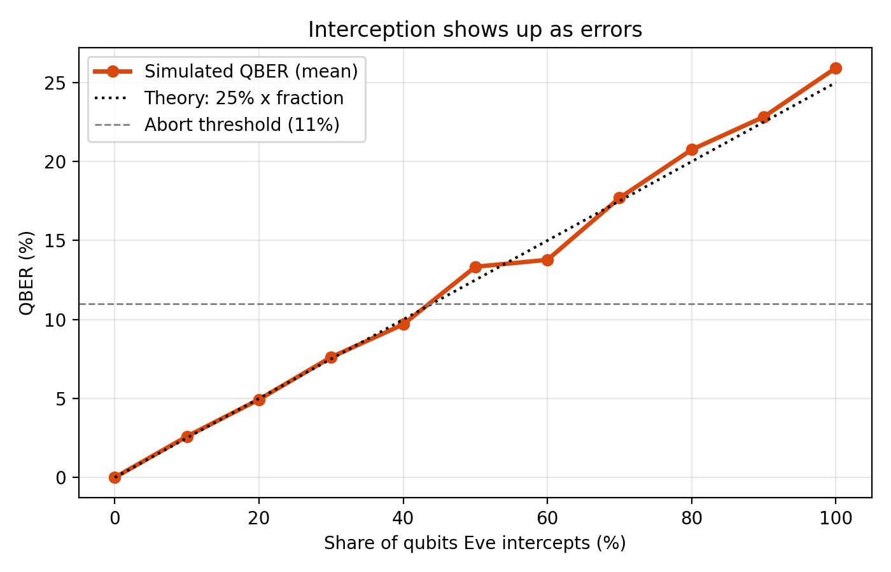
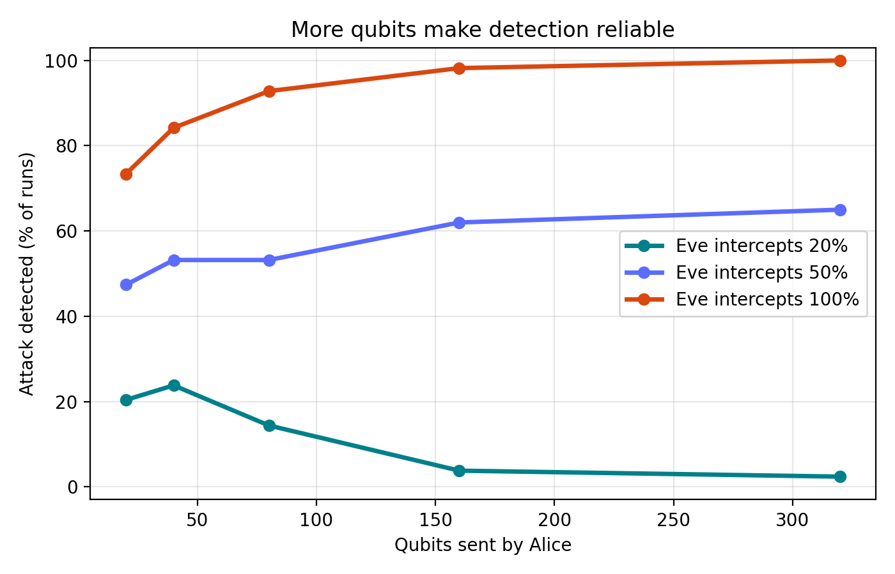
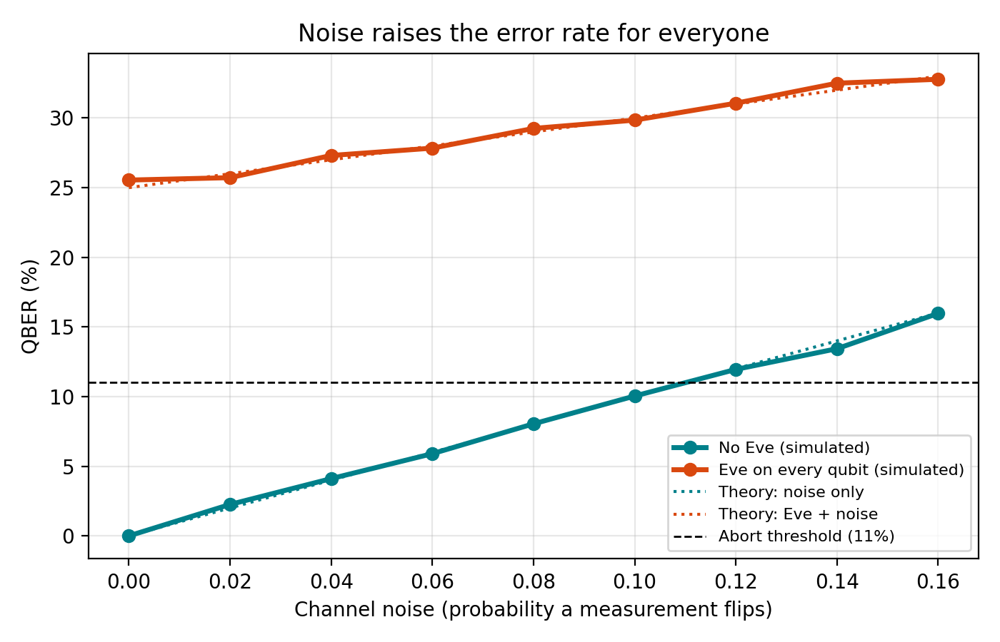
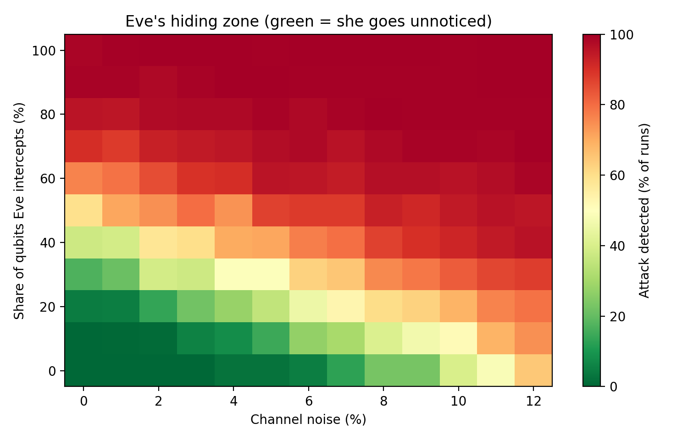

# Quantum Key Distribution (BB84) Under Realistic Noise: Can We Tell Eve Apart from Noise?

> **Qiskit Fall Fest 2026 @ MPSTME, Hybrid Quantum Hackathon**
> *Project: Detecting Interception of a Key Exchange Using Quantum Measurement & Noise-Aware Analysis*

---

## 📌 Problem Statement: Sharing Secrets Safely

Almost all secure communication today (banking, HTTPS, encrypted messaging) starts with two parties agreeing on a shared secret key. Traditional key exchange relies on computational hardness assumptions (e.g., discrete logarithms, integer factoring). Two threats follow:

1. **The Quantum Threat (Shor's Algorithm):** Large-scale quantum computers could solve these mathematical problems efficiently. Encrypted traffic recorded today could be decrypted later ("harvest now, decrypt later").
2. **Invisible Eavesdropping:** Classical bits can be copied without modifying the original data. Alice and Bob have no physical way to know if their transmission was intercepted.

### The BB84 Quantum Solution

The **BB84 protocol** (Bennett & Brassard, 1984) replaces computational assumptions with quantum mechanics:
- **No-Cloning Theorem:** An unknown quantum state cannot be copied, so Eve cannot keep a copy while forwarding the original.
- **Measurement disturbance:** Measuring a qubit in the wrong basis disturbs the state. In an intercept-resend attack, Eve guesses the wrong basis 50% of the time, and that produces about a **25% error rate (QBER)** in the bits Alice and Bob compare.

---

## 🔬 The Central Research Question: "Can We Tell Eve Apart from Noise?"

In textbook BB84 demos, any QBER above **11%** is flagged as an attack. In real quantum communication, though:
- Fiber optic cables suffer from **polarization drift** and thermal fluctuations.
- Single-photon detectors suffer from **dark counts** (false clicks), **afterpulsing**, and **imperfect extinction**.

**The dilemma:** Alice and Bob cannot distinguish a bit flip caused by a detector dark count from a bit flip caused by Eve measuring in the wrong basis. Both appear as the same mismatch in the sifted key.

This project investigates:
1. How random bit flips arise in physical detectors and channels.
2. At what noise level honest key exchanges become unusable because of false alarms.
3. How much an attacker can intercept while staying hidden under the noise floor (**Eve's hiding zone**).

---

## 🛠️ How the Code Is Organised

Everything protocol-related lives in `bb84_qkd.py`, which has two interchangeable engines:

| Engine | What it does | Used for |
|---|---|---|
| **Qiskit (Aer)** | Builds real one-qubit circuits (`X`, `H`, measure) and simulates them. Noise is a `ReadoutError` on Bob's measurement. | The demos in `bb84_qkd.py` |
| **NumPy** | A fast probability model that follows the same two rules: same basis gives the right bit, different basis gives a random bit. | Hundreds of repeated runs in `bb84_studies.py` |

`bb84_studies.py` runs the Monte Carlo experiments. At the start it compares both engines on the same settings.

---

## 📊 Key Results

All numbers below come from `bb84_studies.py` with its default settings and fixed seed. Because of random sampling, your numbers may differ by a few percentage points.

### 1. Interception sweep (`results/qber_vs_eve.png`)
Theory: **QBER ≈ 0.25 × share of qubits Eve intercepts.** Eve guesses the right basis 50% of the time; when she is wrong (50%), Bob's bit is corrupted half the time, so 0.5 × 0.5 = 25%. The simulated QBER tracks this line.



### 2. Random bit flips
Bob's detector is modeled with the confusion matrix

```
[ 1-p   p  ]
[  p   1-p ]
```

so each measurement is reported wrongly with probability `p`. `illustrate_bit_flips()` prints Alice's bits next to Bob's (same bases, no Eve), so you can see flips caused by noise alone.

### 3. Detection reliability vs qubit count (`results/detection_vs_qubits.png`)
- A full attacker (Eve = 100%) is caught in **98%** of runs with 160 qubits and **100%** with 320.
- A weak eavesdropper (Eve = 20%) causes only about 5% QBER, below the 11% threshold, and goes unnoticed in **98%** of runs even with 320 qubits.



### 4. Honest channel noise sweep (`results/noise_sweep.png`)
- At noise of 4% or less, false alarms are about 1% or lower.
- At **8% noise**, **21%** of honest exchanges are falsely flagged as attacks.
- At **10% noise**, **40%** are falsely flagged. A fixed 11% threshold becomes unworkable around here.



### 5. Eve's hiding zone (`results/hiding_zone.png`)
- On a noise-free channel, Eve can intercept up to about **40%** of qubits and still go unnoticed in more than half the runs.
- With 4 to 6% noise, noise uses up the error budget and her window shrinks to roughly **20 to 30%**.
- At 7 to 9% noise it is about **10%**, but honest users already suffer many false alarms.



---

## 🚀 Installation & Usage

Requires Python 3.9+.

```bash
git clone https://github.com/<your-username>/bb84-qkd.git
cd bb84-qkd
python -m venv .venv
# Windows:  .venv\Scripts\activate      Mac/Linux:  source .venv/bin/activate
pip install -r requirements.txt
```

### Run the main BB84 demo
```bash
python bb84_qkd.py
```
This prints three Qiskit demos (no Eve; Eve on every qubit; no Eve with 3% noise), then the bit-flip table, then saves `results/qber_vs_eve.png`.

### Run the Monte Carlo studies
```bash
python bb84_studies.py
```
This takes a few minutes and saves `detection_vs_qubits.png`, `noise_sweep.png`, `hiding_zone.png` and `study_results.json` into `results/`. Set `RUN_QISKIT_CHECK = False` at the top of the file to skip the slower Qiskit comparison.

### Run the tests
```bash
pytest
```

---

## 📽️ Presentation

The hackathon slide deck is in [`docs/bb84_qkd_presentation.pptx`](docs/bb84_qkd_presentation.pptx) (13 slides): problem, why quantum, how BB84 works, a sifting example, the Qiskit implementation, Eve's effect on the error rate, results, noise, qubit counts, Eve's hiding zone, limitations, and conclusion.

---

## 🧪 Project Layout

```
bb84-qkd/
├── bb84_qkd.py        # protocol, both engines, demos
├── bb84_studies.py    # Monte Carlo studies
├── tests/             # pytest checks against theory
├── results/           # generated figures and JSON
├── docs/              # presentation deck
├── requirements.txt
└── LICENSE
```

---

## ⚠️ Limitations & Future Scope

This is a teaching simulation, not a secure implementation.

- Noise is a single bit-flip probability, and only the intercept-resend attack is tested.
- In the Qiskit engine the readout error also applies to Eve's measurement, while the NumPy engine applies noise only at Bob, so the two differ slightly when noise is on (they agree at 0% noise).

Future work:
1. **Error correction (Cascade / Winnow):** real QKD does not discard the key because of small noise; it corrects errors over a public channel.
2. **Privacy amplification:** shrinks the corrected key so that anything Eve learned becomes useless, which addresses the hiding zone.
3. **Decoy-state BB84:** defends against photon-number-splitting attacks when weak laser pulses replace ideal single photons.
4. **Hardware validation:** running on real quantum hardware.

## License

MIT, see [LICENSE](LICENSE).
